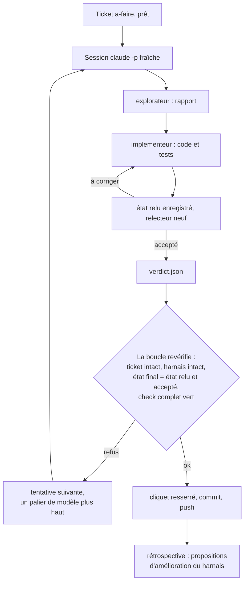

# evolutive-harness

Un harnais Claude Code, Codex et OpenCode à installer dans un projet : un contrôle qualité unique, un cliquet, des
garde-fous, des rôles et une boucle qui traite des tickets un par un. Il se resserre avec le projet
et fait remonter ses améliorations d'un projet à l'autre.

Le principe tient en une phrase : **la session propose, le script décide.** Une session Claude Code,
Codex ou OpenCode fait le travail d'un ticket ; un script qu'elle ne peut pas contourner revérifie tout avant de committer.

## Ce qu'il contient

| Bloc | Où, une fois installé | Rôle |
| --- | --- | --- |
| Contrôle unique | `scripts/check.mjs` | règles par fichier, format, lint, gel du lint, cliquet, suites de tests en séquentiel avec une durée maximale ; appelé par les hooks, la boucle et la CI |
| Cliquet | `scripts/quality/` | des mesures simples (lignes longues, `catch` vides, cas de test…) qui ne peuvent pas se dégrader ; le plancher se resserre à chaque ticket |
| Garde-fous | `.claude/hooks/`, `.codex/hooks.json`, `.opencode/plugins/harness.js` | les mêmes scripts pour Claude, Codex et OpenCode ; en boucle, refusent les commandes destructrices, commit, push, changement de branche, installation non autorisée, écriture hors projet et modification du harnais ; en interactif, demandent confirmation pour les commandes destructrices et la modification du harnais ; fin de tour bloquée sans verdict ou sur un contrôle rouge |
| Rôles | `.claude/agents/` | `explorateur` (lecture seule), `implementeur` (code et tests ensemble), `relecteur` (regard neuf, verdict lu par la machine), `harmoniseur` (corrige les consignes) |
| Méthodes | `.claude/skills/`, `.agents/skills/` | `ticket` (orchestration de bout en bout), `ticket-codex` et `ticket-opencode` (le même travail pour Codex et OpenCode), `decoupage` (écrire des tickets), `tests` (rouge vu, vert minimal), `harmonisation` (consignes corrigées à partir des rétrospectives) |
| Boucle | `scripts/loop/`, `.opencode/agents/` | une session fraîche par ticket, Claude, Codex ou OpenCode, une échelle de modèles par moteur, l'état relu vérifié par empreinte, des relectures de correction, le commit et le push par le script, une rétrospective après chaque ticket, l'harmonisation des consignes, la relève du processus après intégration de son propre code, la reprise après quota |
| Tests du harnais | `tests/harness/` | des centaines de tests qui font tourner hooks, cliquet et boucle dans des dépôts jetables, avec de fausses sessions Claude, Codex et OpenCode |
| Mode d'emploi | `docs/travail/README.md` | lancer la boucle, lire un échec, débloquer un ticket, faire évoluer le harnais |

## Le cycle d'un ticket



## Comment il évolue

Rien ne change sans décision du propriétaire, mais tout est en place pour que le harnais apprenne :

- **Rétrospective.** Après chaque ticket, une courte session en lecture seule relit ce que la boucle a
  observé (tentatives, coûts, refus, verdicts) et propose des changements du harnais, chacun avec sa
  preuve. `node scripts/loop/retro.mjs liste`, puis `decider <id> accepte|refuse|ticket:T0NN`. La session
  interactive annonce à son ouverture le nombre de propositions en attente.
- **Cliquet.** Une mesure améliorée par un ticket devient le nouveau plancher, dans le même commit. Une
  règle qui revient en relecture devient une mesure du projet (`measures` dans `harness.config.mjs`).
- **Échelle de modèles.** Chaque tentative refusée monte d'un palier ; le niveau du ticket fixe le départ
  et le palier minimal du relecteur. L'échelle se règle par projet, à partir des coûts relevés dans
  `.harness-state/loop/events.jsonl`.
- **Harmonisation.** Avec `--tune-every <n>`, les problèmes que les rétrospectives relèvent sur plusieurs
  tickets sont corrigés dans les skills et les agents, jamais dans les contrôles, relus puis committés à part.
- **Tickets de harnais.** Un ticket `harnais: oui` lève le verrou du harnais, et lui seul. En session
  interactive, le propriétaire peut l'ouvrir pour une durée bornée.
- **Remontée entre projets.** Une amélioration faite dans un projet remonte dans ce dépôt (`--compare`,
  `--pull`) ; les autres projets la reçoivent par `--update`.

## Installer

Prérequis : Node 20 ou plus, Git, le CLI `claude` pour la boucle, le CLI `codex` pour son moteur Codex, et
le CLI `opencode` (version 2) pour son moteur OpenCode. Les hooks Codex s'approuvent une fois par dépôt :
`codex` à la racine, puis `/hooks`. OpenCode charge son plugin sans approbation ; ses identifiants de
fournisseur se règlent une fois avec `opencode auth login`.

```sh
git clone git@github.com:DabiK/evolutive-harness.git
node evolutive-harness/install.mjs ../mon-projet --dry-run   # ce qui serait installé
node evolutive-harness/install.mjs ../mon-projet
```

Le projet doit être la racine d'un dépôt Git. L'installation refuse d'écraser un fichier existant du
projet qui diffère (`--force` pour passer outre). Elle fusionne `.claude/settings.json` (les hooks et réglages du projet restent) et ajoute
`.harness-state/` au `.gitignore`. Ensuite, dans le projet :

1. Adapter `harness.config.mjs`, `CLAUDE.md` et `docs/standards.md` (les passages entre chevrons).
2. `node scripts/quality/ratchet.mjs --init` pour poser le plancher du cliquet.
3. `node scripts/check.mjs` : il doit être vert.
4. Committer, écrire un premier ticket avec la skill `decoupage`, puis
   `node scripts/loop/run.mjs --dry-run`.

## Mettre à jour, comparer, remonter

Trois sortes de fichiers :

| Sorte | Fichiers | `--update` |
| --- | --- | --- |
| Noyau | tout le reste du modèle | remplacé, sauf s'il a été modifié dans le projet |
| Projet | `CLAUDE.md`, `AGENTS.md` (lien vers `CLAUDE.md`), `harness.config.mjs`, `docs/standards.md` | ajouté s'il manque, jamais touché ensuite |
| Fusionné | `.claude/settings.json`, `.gitignore` | hooks du harnais remplacés, le reste gardé |

Le verrou `.claude/harness.lock.json`, à committer dans le projet, garde l'empreinte de chaque fichier
du noyau tel qu'il a été installé. C'est lui qui distingue « modifié dans le projet » de « modifié
dans le modèle ».

```sh
node install.mjs ../mon-projet --update                  # apporte le nouveau noyau
node install.mjs ../mon-projet --compare --diff          # ce qui a divergé, dans les deux sens
node install.mjs ../mon-projet --pull scripts/loop/run.mjs   # reprend l'amélioration du projet ici
npm test                                                 # puis relire, committer, pousser
```

Un fichier du noyau modifié dans le projet n'est jamais écrasé sans `--force` : `--update` le signale,
`--compare --diff` montre l'écart. Il reste alors à le remonter (`--pull`) ou à l'écraser.

## Configurer

`harness.config.mjs`, à la racine du projet. Valeurs par défaut dans `scripts/quality/config.mjs`.

| Clé | Défaut | Rôle |
| --- | --- | --- |
| `project` | `"projet"` | nom des sessions de la boucle et de la rétrospective |
| `productionDirs` | `["src"]` | code de production : `catch` vides, mesures du cliquet |
| `testDir` | `"tests"` | tests du projet, comptés par le cliquet |
| `codeFiles`, `testFiles`, `testCase` | JS, TS et Python ; `*.test.*`, `*.spec.*`, `test_*.py` ; `test(`, `it(`, `def test_` | fichiers de code, fichiers de test, déclaration d'un cas de test |
| `maxLineLength` | `160` | longueur maximale d'une ligne |
| `suites` | aucune | `{ name, command, files }` : la commande reçoit les fichiers de la suite (tous, ou ceux modifiés avec `--changed`) |
| `measures` | aucune | `{ pattern, direction, perFile, except }` : un motif compté dans le code de production, ajouté au cliquet |
| `models` | les échelles de `scripts/loop/models.mjs` | `ladder`, `codexLadder`, `opencodeLadder`, `levels`, `retro` : échelles Claude, Codex et OpenCode de la boucle, niveaux de ticket, modèle de la rétrospective |

La boucle passe à ses sessions les variables `HARNESS_LOOP`, `HARNESS_TICKET`, `HARNESS_TICKET_FILE`,
`HARNESS_ALLOW_INSTALL`, `HARNESS_EDIT` (ticket de harnais), `HARNESS_EDIT_SCOPE` (portée d'une
harmonisation), `HARNESS_REVIEW_MODEL`, `HARNESS_ENGINE` (`codex` ou `opencode` pour une session de ce
moteur), `HARNESS_HOOK_RUN` (témoin de chargement des hooks Codex et du plugin OpenCode) et `HARNESS_TUNE` ;
une session OpenCode reçoit aussi `OPENCODE_CONFIG_DIR`, un dossier vide. `HARNESS_CLAUDE_BIN`,
`HARNESS_CODEX_BIN` et `HARNESS_OPENCODE_BIN` remplacent les CLI `claude`, `codex` et `opencode` (les tests y
mettent de fausses sessions) ;
`HARNESS_CODEX_SKIP_CAPACITY_WAIT` supprime l'attente entre deux reprises de capacité ;
`HARNESS_TEST_BUDGET_MS` borne la durée d'une suite de tests.

## Développer ce dépôt

```
install.mjs          installation, mise à jour, comparaison, remontée
template/            ce qui est copié dans un projet, à la même place
tests/               tests de l'installeur
CHANGELOG.md         ce que chaque version change, pour qui lance --update
```

`npm test` lance les tests de l'installeur puis ceux du harnais, en séquentiel (cinq minutes environ).
Une évolution du noyau se fait avec son test, comme dans un projet, puis s'inscrit dans `CHANGELOG.md`.

## Limites

- Les garde-fous lisent le texte des commandes : ils rattrapent l'erreur, pas la malveillance. Ce
  n'est pas un bac à sable.
- La boucle lit le flux `stream-json` de Claude Code (`result`, `modelUsage`, `permission_denials`,
  `tool_use_result.agentType`, `handbackReport`), le flux `--json` de `codex exec` (événements de
  session, de tour et d'erreur, messages de capacité et de quota) et le flux `--format json` de
  `opencode run` (`step_start`, `tool_use`, `step_finish`, `error`, `sessionID`), complété par
  `opencode session export` pour le coût. Les tests les simulent avec de fausses sessions : un changement
  de format d'un CLI ne les ferait pas échouer. Après une mise à jour de Claude Code, de Codex ou
  d'OpenCode, vérifier un vrai ticket avec `--max 1`.
- Le moteur OpenCode dépend de l'API des plugins d'OpenCode 2 (hooks `tool.execute.before` et `after`,
  `permission.evaluate`, `session.prompt`, `session.compaction`), relevée sur la version 2.0.22, et de
  `opencode run --standalone`. Le quota et la saturation d'un fournisseur OpenCode ne sont pas reconnus
  à part : ils refusent la tentative comme une autre erreur.
- Le moteur Codex dépend d'options de `codex exec` (`--disable`, `--dangerously-bypass-hook-trust`,
  `exec resume`) et de l'approbation de `.codex/hooks.json` dans la config de l'utilisateur, liée au
  chemin absolu du dépôt : un worktree ou une copie demande sa propre approbation.
- Les scripts sont en Node. Un projet Python ou autre les utilise tels quels, avec ses propres suites
  dans `harness.config.mjs` ; la règle des `catch` vides ne vise que JavaScript et TypeScript.
- Le format (Prettier) et le lint (ESLint) du projet ne jugent pas le noyau du harnais, qui suit son
  propre style.
- Les consignes, skills et messages sont en français, comme les phrases exactes que la boucle lit
  (« Décision attendue du propriétaire », `VERDICT : accepté`, `CONSTATS : …`).

## Origine

Extrait le 14 octobre 2026 du harnais de TVLens (commit `49cfbb4`), avec le ticket de harnais T153 alors
en cours : un relecteur n'accepte que sans constat dans le périmètre, et les écarts aux critères sont
déclarés avant l'implémentation. Mis à jour le 19 octobre 2026 jusqu'au commit TVLens `b893bae` (version
0.2.0 : moteur Codex, harmonisation, relève, quota ; voir `CHANGELOG.md`), puis doté du moteur OpenCode
(version 0.3.0). TVLens était parti du squelette harness-codex-claude. Les skills
`decoupage` et `tests` sont adaptées de mattpocock/skills (licence MIT).
